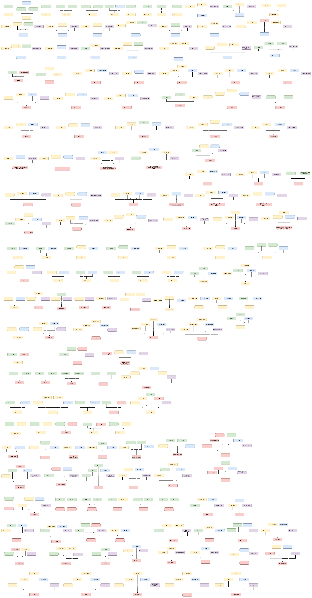

# The Wudlands — Player's Guide

Welcome, adventurer. The Wudlands is an old-school round-based Fighting Fantasy-style RPG — inspired by UltraQuest, Lone Wolf Saga, EverQuest, Dungeon Crawl Classic, and the books of Steve Jackson and Ian Livingstone — with scene-driven gameplay, pixel-art, ascii-art, narrative-driven adventures, and onchain character progression.

Visit [The Wudlands](https://thewudlands.eu/) to begin your journey.

## Soul Creation Slots

A player's welcome page shows ten soul-creation slots. The first is free and open to everyone — it is clickable the moment the page renders, without waiting on any lookup. The other nine are earned by what the player's wallet holds: an NFT from a specific collection, a total token balance, or a number of Grid Miner stars. Locked slots still show their artwork, greyed out, so a player can see what each reward looks like before qualifying for it.

Requirements are read from two public sources. Token balances and NFT collection ownership come from the Subscan API in a single call per chain, covering both Polkadot Asset Hub and Hydration — fast enough for the page to wait on. The Grid Miner star count is slower: it reads every owned item from Asset Hub's `nfts` pallet over RPC, then fetches each item's metadata document from IPFS to total the `Stars` trait. Those two slots therefore resolve on a second, background request and keep their loading indicator until it returns, so the rest of the grid is never held up.

Token thresholds are cumulative — holding 5B WUD unlocks the 1B slot as well. Balances are summed across both chains.

| Slot | Requirement | Source | Speed |
|------|---|---|---|
| 1 | Free — open to everyone | — | Immediate |
| 2 | WUD 1st Year NFT | Asset Hub collection 441 | Fast |
| 3 | WUD 2nd Year NFT | Asset Hub collection 842 | Fast |
| 4 | OG WUD BURN NFT | Asset Hub collection 244 | Fast |
| 5 | 1,000,000,000 WUD | Asset Hub + Hydration balance | Fast |
| 6 | 5,000,000,000 WUD | Asset Hub + Hydration balance | Fast |
| 7 | 1,000 DOT | Asset Hub + Hydration balance | Fast |
| 8 | 5,000 DOT | Asset Hub + Hydration balance | Fast |
| 9 | 20 Grid Miner stars | Collection 852 metadata (IPFS) | Background |
| 10 | 100 Grid Miner stars | Collection 852 metadata (IPFS) | Background |

Results are stored per wallet so the checks do not run on every visit. A player with no stored record is always checked; after that, roughly one login in thirty-three re-verifies, which keeps the unlock state current without spending the API quota on data that rarely changes. A "Reload Balances & NFTs" button on the welcome page forces an immediate re-check outside that schedule, for a player who wants to confirm a fresh balance or NFT right away. If the NFT/token lookup cannot run at all — no API key configured, or Subscan is unreachable — those slots are reset to unearned and that reset is stored, the same as any other fresh result; the grid never keeps reporting a wallet unlocked from a check it can no longer confirm. The Grid Miner star slots are unaffected by a Subscan outage, since they resolve over RPC and IPFS instead.

## Class & Profession Level Progression

Character classes and crafting professions level from 1 to 30, using a shared XP curve that starts cheap and escalates steadily rather than exploding: each level costs roughly 1.2× the previous one's XP, so early levels come fast while level 30 asks for real investment. The table below is the reference progression chart — `Total XP` is the cumulative XP needed to reach that level, `Diff` is how much more that level costs than the one before it.

Profession level also governs what happens when a craft fails: at low levels a failed craft can lose few of the ingredients, while higher levels let the crafter salvage and save back some of the material, softening the risk as mastery grows.

| Level | Total XP | Diff to previous |
|-------|----------|-------------------|
| 1  | 0       | —      |
| 2  | 100     | 100    |
| 3  | 220     | 120    |
| 4  | 360     | 140    |
| 5  | 540     | 180    |
| 6  | 740     | 200    |
| 7  | 1,000   | 260    |
| 8  | 1,300   | 300    |
| 9  | 1,600   | 300    |
| 10 | 2,100   | 500    |
| 11 | 2,600   | 500    |
| 12 | 3,200   | 600    |
| 13 | 4,000   | 800    |
| 14 | 4,800   | 800    |
| 15 | 5,900   | 1,100  |
| 16 | 7,200   | 1,300  |
| 17 | 8,700   | 1,500  |
| 18 | 11,000  | 2,300  |
| 19 | 13,000  | 2,000  |
| 20 | 15,000  | 2,000  |
| 21 | 19,000  | 4,000  |
| 22 | 23,000  | 4,000  |
| 23 | 27,000  | 4,000  |
| 24 | 33,000  | 6,000  |
| 25 | 39,000  | 6,000  |
| 26 | 47,000  | 8,000  |
| 27 | 57,000  | 10,000 |
| 28 | 68,000  | 11,000 |
| 29 | 82,000  | 14,000 |
| 30 | 100,000 | 18,000 |

## Professions: Raw Materials and Starting Blueprints

Every profession works with 3 raw-material families. They decide what its soul slot can forage, which raw materials earn it crafting XP, its salvage bonus and the starter materials it may pick at creation. Every raw material belongs to at least one profession.

Every profession also has its own blueprints - the things its trade makes ("Own") - and blueprints it may pick because it uses them ("Also Offered"). At character creation you pick **1 starting blueprint** from your professions' lists, at the tier of your number of professions (1 profession: T1, 2: T2, 3: T3). Every blueprint is owned by at least one profession, so anything that can be crafted has a profession whose trade it is - and characters depend on each other for the rest: a sword needs a kiln, a furnace and an anvil, each another trade's station.

Every armor piece has its own blueprint: an iron helmet, breastplate and greaves are three blueprints, learned and picked separately.

<!-- BEGIN generated: professions -->
| Category | Profession | Raw Materials | Own Blueprints | Also Offered |
|---|---|---|---|---|
| Alchemy | alchemist | herbs, essence, crystal | alchemy_stand, antidote_potion, healing_potion, mana_potion, meteoric_iron_chest_armor, meteoric_iron_head_armor, meteoric_iron_leg_armor, meteoric_iron_shield, mortar_and_pestle | - |
| Alchemy | enchanter | essence, crystal, wood | enchanters_table, lapidary_bench, magic_staff, starlight_catcher, wand | holy_symbol, mana_potion, meteoric_iron_chest_armor, meteoric_iron_head_armor, meteoric_iron_leg_armor, meteoric_iron_shield |
| Alchemy | poisoner | venom, herbs, monster_part | alchemy_stand, antidote_potion, mortar_and_pestle, venom_vial | chitin_chest_armor, chitin_head_armor, chitin_leg_armor, dagger |
| Aristocratic | clerk | reed, skin, feather | holy_symbol | bridle, hourglass, lock_and_key, merchants_scale, scriptorium |
| Aristocratic | scholar | crystal, reed, feather | spyglass | chalk, enchanters_table, holy_symbol, hourglass, magic_staff, scriptorium, starlight_catcher, wand, written_scroll |
| Aristocratic | scribe | reed, skin, feather | scriptorium, written_scroll | wand, workbench |
| Artists | acrobat | feather, fiber, bone | - | bridle, cloth_chest_armor, cloth_cloak, cloth_head_armor, cloth_leg_armor, quilted_cloak, saddlepack |
| Artists | actor | feather, fiber, bone | - | cloth_chest_armor, cloth_cloak, cloth_head_armor, cloth_leg_armor, dagger, mirror, quilted_cloak, saddlepack |
| Artists | clown | feather, fiber, bone | - | bolt_girdle, cloth_chest_armor, cloth_cloak, cloth_head_armor, cloth_leg_armor, quilted_cloak, saddlepack, signal_whistle |
| Artists | firespitter | feather, fiber, bone | - | alchemy_stand, cloth_chest_armor, cloth_cloak, cloth_head_armor, cloth_leg_armor, quilted_cloak, wand |
| Artists | painter | pigment, stone, feather | chalk | lapidary_bench, mortar_and_pestle, workbench |
| Artists | storyteller | feather, fiber, bone | - | bridle, cloth_cloak, quilted_cloak, saddlepack, scriptorium, wand, written_scroll |
| CraftArmor | armorer | ore, wood, sand | anvil, chainmail_chest_armor, chainmail_head_armor, chainmail_leg_armor, darksteel_chest_armor, darksteel_head_armor, darksteel_leg_armor, darksteel_shield, iron_chest_armor, iron_head_armor, iron_leg_armor, iron_shield | reinforced_wooden_shield |
| CraftFurniture | carpenter | wood, fiber, bone | enchanters_table, ladder, loom, oven, scriptorium, spinning_wheel, tanning_rack, workbench | cart |
| CraftGarment | dyer | pigment, herbs, fiber | lacquer, mortar_and_pestle | chitin_shield, cloth_cloak, ebony_chest_armor, ebony_head_armor, ebony_leg_armor, ebony_shield, quilted_cloak |
| CraftGarment | leatherworker | hide, skin, bone | bolt_girdle, leather_chest_armor, leather_cloak, leather_head_armor, leather_leg_armor, saddle, saddlepack, workbench | - |
| CraftGarment | tanner | hide, skin, monster_part | barding_leather, chitin_chest_armor, chitin_head_armor, chitin_leg_armor, chitin_shield, fur_cloak, tanning_rack | - |
| CraftGarment | weaver | fiber, feather, reed | bridle, cloth_chest_armor, cloth_cloak, cloth_head_armor, cloth_leg_armor, loom, quilted_cloak, spinning_wheel | - |
| CraftGlass | glassblower | sand, crystal, ore | alchemy_stand, furnace, glass_lantern, hourglass, kiln, lapidary_bench, mirror | - |
| CraftGlass | jeweler | crystal, ore, sand | grinding_stone, lapidary_bench, magic_staff, mirror, wand | holy_symbol, meteoric_iron_chest_armor, meteoric_iron_head_armor, meteoric_iron_leg_armor, meteoric_iron_shield |
| CraftStone | mason | stone, clay, sand | furnace, grinding_stone, kiln, oven | pickaxe |
| CraftStone | potter | clay, sand, stone | alchemy_stand, kiln, mortar_and_pestle | shovel |
| CraftStone | stonemason | stone, crystal, clay | furnace, grinding_stone, lapidary_bench, mortar_and_pestle | pickaxe |
| CraftTool | tinsmith | ore, clockwork, wood | barding_iron, chain, crossbow, crowbar, grappling_hook, lock_and_key, manacles, merchants_scale, quiver, wrench | darksteel_chest_armor, darksteel_head_armor, darksteel_leg_armor, darksteel_shield |
| CraftWeapon | blacksmith | ore, wood, sand | anvil, axe, battle_axe, dagger, greatsword, mace, short_sword, sickle, spear, sword, warhammer, whetstone | - |
| CraftWood | cooper | wood, bone, pigment | bolt_girdle, bow, crossbow, ebony_chest_armor, ebony_head_armor, ebony_leg_armor, ebony_shield, quiver, reinforced_wooden_shield, wooden_shield, workbench | - |
| Food | baker | harvest, herbs, wood | fig_cake, fishermans_ration, iron_ration, oven | mortar_and_pestle |
| Food | brewmaster | harvest, herbs, fish | mortar_and_pestle, oven, pickled_fish | alchemy_stand |
| Food | butcher | meat, bone, herbs | jerky, smokehouse | whetstone |
| Food | cook | meat, fish, harvest | oven, roasted_nuts | fig_cake, iron_ration, pickled_fish, smoked_fish |
| Military | guard | ore, hide, monster_part | - | chain, chainmail_chest_armor, chainmail_head_armor, chainmail_leg_armor, crossbow, lock_and_key, mace, manacles, reinforced_wooden_shield, signal_whistle, spear, wooden_shield |
| Military | soldier | ore, fiber, monster_part | - | barding_iron, cloth_chest_armor, cloth_head_armor, cloth_leg_armor, grappling_hook, iron_chest_armor, iron_head_armor, iron_leg_armor, iron_ration, iron_shield, short_sword, signal_whistle, spear, spyglass, sword |
| Rural | farmer | harvest, fiber, herbs | oven, shovel, sickle, smokehouse, spinning_wheel | ladder, roasted_nuts |
| Rural | fisher | fish, reed, fiber | fishermans_ration, fishing_pole, net, smoked_fish, smokehouse | pickled_fish, spear |
| Rural | herder | hide, meat, fiber | bridle, saddle, signal_whistle, spinning_wheel, tanning_rack | barding_leather, cart, fur_cloak, leather_cloak |
| Rural | hunter | meat, hide, feather | bow, hunters_charm, monster_trap, quiver, smokehouse, spear, tanning_rack | fur_cloak, jerky, leather_chest_armor, leather_cloak, leather_head_armor, leather_leg_armor, net, spyglass, whetstone |
| Rural | miner | ore, stone, crystal | furnace, grinding_stone, kiln, pickaxe | crowbar, glass_lantern, shovel, warhammer |
| Trade | merchant | wood, harvest, monster_part | cart | barding_leather, bridle, leather_cloak, merchants_scale, saddle, saddlepack |
| Trade | trader | harvest, stone, monster_part | cart | bridle, fig_cake, iron_ration, jerky, leather_cloak, merchants_scale, pickled_fish, roasted_nuts, saddlepack, smoked_fish, smokehouse |
<!-- END generated: professions -->

## Crafting XP

Each profession can gain at most 30% of its current level's XP cost per day, from raw-material and final-item XP combined — grinding past that cap earns nothing more until the next day.

Crafting pays out two kinds of XP, which can land on different professions from the same craft. **Raw-material XP** is automatic: we count all raw materials used across a recipe's full creation chain, but not tools or other ingredients that already have their own blueprint. Consuming a raw material grants XP equal to the amount consumed to every profession the character has that works that material (see Professions: Raw Materials and Starting Blueprints) — a single craft can pay out to more than one profession at once if its raw materials overlap across professions.

**Final-item XP** only applies to genuinely blueprint-gated tools and items (not plain processing steps like refining ore or tanning leather): finishing one pays out a flat, tier-scaled assembly bonus — `10% × the item's full raw-material chain × its tier` — on top of whatever raw-material XP was already earned crafting its ingredients. Unlike raw-material XP, this bonus isn't tied to a fixed profession — the character's selected prime profession receives it.

<!-- BEGIN generated: blueprint-xp -->
| Item | Blueprint | Raw XP | Raw Materials | T1 Bonus | T2 Bonus | T3 Bonus | T4 Bonus | T5 Bonus | T6 Bonus | T1 Total XP |
|---|---|---:|---|---:|---:|---:|---:|---:|---:|---:|
| Ebony Shield | Ebony Shield | 530 | Pigment x240, Herbs x144, Wood x96, Bone x50 | 53 | 106 | 159 | 212 | 265 | 318 | 583 |
| Chitin Shield | Chitin Shield | 507 | Pigment x240, Herbs x144, Hide x72, Wood x36, Monster Part x15 | 51 | 101 | 152 | 203 | 254 | 304 | 558 |
| Greatsword | Greatsword | 486 | Ore x375, Wood x111 | 49 | 97 | 146 | 194 | 243 | 292 | 535 |
| Warhammer | Warhammer | 486 | Ore x375, Wood x111 | 49 | 97 | 146 | 194 | 243 | 292 | 535 |
| Battle Axe | Battle Axe | 478 | Ore x375, Wood x103 | 48 | 96 | 143 | 191 | 239 | 287 | 526 |
| Anvil | Anvil | 376 | Ore x310, Wood x66 | 38 | 75 | 113 | 150 | 188 | 226 | 414 |
| Darksteel Chest Armor | Darksteel Chest Armor | 361 | Ore x300, Wood x33, Clockwork x28 | 36 | 72 | 108 | 144 | 180 | 217 | 397 |
| Darksteel Head Armor | Darksteel Head Armor | 361 | Ore x300, Wood x33, Clockwork x28 | 36 | 72 | 108 | 144 | 180 | 217 | 397 |
| Darksteel Leg Armor | Darksteel Leg Armor | 361 | Ore x300, Wood x33, Clockwork x28 | 36 | 72 | 108 | 144 | 180 | 217 | 397 |
| Meteoric Iron Chest Armor | Meteoric Iron Chest Armor | 350 | Crystal x140, Ore x120, Essence x90 | 35 | 70 | 105 | 140 | 175 | 210 | 385 |
| Meteoric Iron Head Armor | Meteoric Iron Head Armor | 350 | Crystal x140, Ore x120, Essence x90 | 35 | 70 | 105 | 140 | 175 | 210 | 385 |
| Meteoric Iron Leg Armor | Meteoric Iron Leg Armor | 350 | Crystal x140, Ore x120, Essence x90 | 35 | 70 | 105 | 140 | 175 | 210 | 385 |
| Ebony Chest Armor | Ebony Chest Armor | 340 | Wood x132, Bone x80, Pigment x80, Herbs x48 | 34 | 68 | 102 | 136 | 170 | 204 | 374 |
| Ebony Head Armor | Ebony Head Armor | 340 | Wood x132, Bone x80, Pigment x80, Herbs x48 | 34 | 68 | 102 | 136 | 170 | 204 | 374 |
| Ebony Leg Armor | Ebony Leg Armor | 340 | Wood x132, Bone x80, Pigment x80, Herbs x48 | 34 | 68 | 102 | 136 | 170 | 204 | 374 |
| Mace | Mace | 320 | Ore x250, Wood x70 | 32 | 64 | 96 | 128 | 160 | 192 | 352 |
| Sword | Sword | 320 | Ore x250, Wood x70 | 32 | 64 | 96 | 128 | 160 | 192 | 352 |
| Iron Chest Armor | Iron Chest Armor | 316 | Ore x250, Wood x66 | 32 | 63 | 95 | 126 | 158 | 190 | 348 |
| Iron Head Armor | Iron Head Armor | 316 | Ore x250, Wood x66 | 32 | 63 | 95 | 126 | 158 | 190 | 348 |
| Iron Leg Armor | Iron Leg Armor | 316 | Ore x250, Wood x66 | 32 | 63 | 95 | 126 | 158 | 190 | 348 |
| Chitin Chest Armor | Chitin Chest Armor | 314 | Hide x144, Pigment x80, Herbs x48, Monster Part x30, Wood x12 | 31 | 63 | 94 | 126 | 157 | 188 | 345 |
| Chitin Head Armor | Chitin Head Armor | 314 | Hide x144, Pigment x80, Herbs x48, Monster Part x30, Wood x12 | 31 | 63 | 94 | 126 | 157 | 188 | 345 |
| Chitin Leg Armor | Chitin Leg Armor | 314 | Hide x144, Pigment x80, Herbs x48, Monster Part x30, Wood x12 | 31 | 63 | 94 | 126 | 157 | 188 | 345 |
| Chainmail Chest Armor | Chainmail Chest Armor | 258 | Ore x225, Wood x33 | 26 | 52 | 77 | 103 | 129 | 155 | 284 |
| Chainmail Head Armor | Chainmail Head Armor | 258 | Ore x225, Wood x33 | 26 | 52 | 77 | 103 | 129 | 155 | 284 |
| Chainmail Leg Armor | Chainmail Leg Armor | 258 | Ore x225, Wood x33 | 26 | 52 | 77 | 103 | 129 | 155 | 284 |
| Darksteel Shield | Darksteel Shield | 245 | Ore x200, Wood x33, Clockwork x12 | 24 | 49 | 74 | 98 | 122 | 147 | 269 |
| Axe | Axe | 229 | Ore x180, Wood x49 | 23 | 46 | 69 | 92 | 115 | 137 | 252 |
| Meteoric Iron Shield | Meteoric Iron Shield | 215 | Crystal x86, Ore x75, Essence x54 | 22 | 43 | 64 | 86 | 108 | 129 | 237 |
| Short Sword | Short Sword | 197 | Ore x150, Wood x47 | 20 | 39 | 59 | 79 | 99 | 118 | 217 |
| Crossbow | Crossbow | 171 | Ore x75, Wood x60, Fiber x36 | 17 | 34 | 51 | 68 | 86 | 103 | 188 |
| Reinforced Wooden Shield | Reinforced Wooden Shield | 170 | Ore x125, Wood x45 | 17 | 34 | 51 | 68 | 85 | 102 | 187 |
| Spear | Spear | 166 | Ore x125, Wood x41 | 17 | 33 | 50 | 66 | 83 | 100 | 183 |
| Iron Shield | Iron Shield | 162 | Ore x125, Wood x37 | 16 | 32 | 49 | 65 | 81 | 97 | 178 |
| Sickle | Sickle | 162 | Ore x125, Wood x37 | 16 | 32 | 49 | 65 | 81 | 97 | 178 |
| Pickaxe | Pickaxe | 160 | Ore x125, Wood x35 | 16 | 32 | 48 | 64 | 80 | 96 | 176 |
| Dagger | Dagger | 158 | Ore x125, Wood x33 | 16 | 32 | 47 | 63 | 79 | 95 | 174 |
| Bow | Bow | 152 | Fiber x132, Wood x20 | 15 | 30 | 46 | 61 | 76 | 91 | 167 |
| Leather Chest Armor | Leather Chest Armor | 150 | Hide x120, Wood x18, Bone x12 | 15 | 30 | 45 | 60 | 75 | 90 | 165 |
| Leather Head Armor | Leather Head Armor | 150 | Hide x120, Wood x18, Bone x12 | 15 | 30 | 45 | 60 | 75 | 90 | 165 |
| Leather Leg Armor | Leather Leg Armor | 150 | Hide x120, Wood x18, Bone x12 | 15 | 30 | 45 | 60 | 75 | 90 | 165 |
| Lacquer | Lacquer | 140 | Pigment x80, Herbs x48, Wood x12 | 14 | 28 | 42 | 56 | 70 | 84 | 154 |
| Kiln | Kiln | 86 | Clay x60, Sand x20, Stone x6 | 9 | 17 | 26 | 34 | 43 | 52 | 95 |
| Furnace | Furnace | 74 | Clay x36, Stone x16, Sand x12, Ore x10 | 7 | 15 | 22 | 30 | 37 | 44 | 81 |
| Cloth Chest Armor | Cloth Chest Armor | 72 | Fiber x72 | 7 | 14 | 22 | 29 | 36 | 43 | 79 |
| Cloth Head Armor | Cloth Head Armor | 72 | Fiber x72 | 7 | 14 | 22 | 29 | 36 | 43 | 79 |
| Cloth Leg Armor | Cloth Leg Armor | 72 | Fiber x72 | 7 | 14 | 22 | 29 | 36 | 43 | 79 |
| Loom | Loom | 62 | Wood x46, Fiber x12, Bone x4 | 6 | 12 | 19 | 25 | 31 | 37 | 68 |
| Barding Leather | Barding Leather | 58 | Hide x48, Monster Part x10 | 6 | 12 | 17 | 23 | 29 | 35 | 64 |
| Lapidary Bench | Lapidary Bench | 54 | Clay x24, Stone x12, Ore x10, Sand x8 | 5 | 11 | 16 | 22 | 27 | 32 | 59 |
| Grinding Stone | Grinding Stone | 51 | Clay x24, Stone x14, Sand x8, Ore x5 | 5 | 10 | 15 | 20 | 26 | 31 | 56 |
| Antidote Potion | Antidote Potion | 44 | Herbs x26, Sand x12, Venom x6 | 4 | 9 | 13 | 18 | 22 | 26 | 48 |
| Saddlepack | Saddlepack | 44 | Hide x26, Fiber x18 | 4 | 9 | 13 | 18 | 22 | 26 | 48 |
| Enchanters Table | Enchanters Table | 42 | Wood x30, Crystal x6, Bone x4, Herbs x1, Monster Part x1 | 4 | 8 | 13 | 17 | 21 | 25 | 46 |
| Healing Potion | Healing Potion | 42 | Herbs x26, Sand x12, Harvest x4 | 4 | 8 | 13 | 17 | 21 | 25 | 46 |
| Mana Potion | Mana Potion | 42 | Crystal x15, Sand x12, Essence x9, Monster Part x6 | 4 | 8 | 13 | 17 | 21 | 25 | 46 |
| Scriptorium | Scriptorium | 39 | Wood x30, Fiber x5, Bone x4 | 4 | 8 | 12 | 16 | 20 | 23 | 43 |
| Saddle | Saddle | 37 | Hide x32, Wood x3, Bone x2 | 4 | 7 | 11 | 15 | 18 | 22 | 41 |
| Workbench | Workbench | 37 | Wood x30, Bone x4, Feather x1, Reed x1, Skin x1 | 4 | 7 | 11 | 15 | 18 | 22 | 41 |
| Barding Iron | Barding Iron | 36 | Ore x20, Hide x12, Bone x2, Fish x2 | 4 | 7 | 11 | 14 | 18 | 22 | 40 |
| Tanning Rack | Tanning Rack | 34 | Wood x24, Ore x10 | 3 | 7 | 10 | 14 | 17 | 20 | 37 |
| Shovel | Shovel | 33 | Ore x25, Wood x8 | 3 | 7 | 10 | 13 | 16 | 20 | 36 |
| Venom Vial | Venom Vial | 33 | Herbs x12, Sand x12, Venom x9 | 3 | 7 | 10 | 13 | 16 | 20 | 36 |
| Cart | Cart | 32 | Wood x32 | 3 | 6 | 10 | 13 | 16 | 19 | 35 |
| Alchemy Stand | Alchemy Stand | 31 | Clay x18, Sand x6, Ore x5, Stone x2 | 3 | 6 | 9 | 12 | 16 | 19 | 34 |
| Glass Lantern | Glass Lantern | 30 | Sand x12, Ore x10, Crystal x3, Meat x3, Bone x2 | 3 | 6 | 9 | 12 | 15 | 18 | 33 |
| Wooden Shield | Wooden Shield | 28 | Wood x16, Hide x12 | 3 | 6 | 8 | 11 | 14 | 17 | 31 |
| Leather Cloak | Leather Cloak | 26 | Hide x18, Fiber x6, Bone x1, Fish x1 | 3 | 5 | 8 | 10 | 13 | 16 | 29 |
| Cloth Cloak | Cloth Cloak | 25 | Fiber x25 | 2 | 5 | 8 | 10 | 12 | 15 | 27 |
| Spinning Wheel | Spinning Wheel | 25 | Wood x23, Bone x2 | 2 | 5 | 8 | 10 | 12 | 15 | 27 |
| Bolt Girdle | Bolt Girdle | 24 | Hide x12, Wood x12 | 2 | 5 | 7 | 10 | 12 | 14 | 26 |
| Fur Cloak | Fur Cloak | 24 | Hide x24 | 2 | 5 | 7 | 10 | 12 | 14 | 26 |
| Quilted Cloak | Quilted Cloak | 24 | Feather x24 | 2 | 5 | 7 | 10 | 12 | 14 | 26 |
| Bridle | Bridle | 22 | Fiber x12, Hide x8, Bone x1, Fish x1 | 2 | 4 | 7 | 9 | 11 | 13 | 24 |
| Hunters Charm | Hunters Charm | 22 | Monster Part x12, Bone x10 | 2 | 4 | 7 | 9 | 11 | 13 | 24 |
| Jerky | Jerky | 22 | Meat x9, Bone x6, Wood x5, Herbs x2 | 2 | 4 | 7 | 9 | 11 | 13 | 24 |
| Magic Staff | Magic Staff | 22 | Wood x16, Crystal x6 | 2 | 4 | 7 | 9 | 11 | 13 | 24 |
| Quiver | Quiver | 22 | Wood x16, Ore x5, Skin x1 | 2 | 4 | 7 | 9 | 11 | 13 | 24 |
| Chain | Chain | 20 | Ore x20 | 2 | 4 | 6 | 8 | 10 | 12 | 22 |
| Mortar And Pestle | Mortar And Pestle | 20 | Clay x12, Sand x4, Stone x4 | 2 | 4 | 6 | 8 | 10 | 12 | 22 |
| Smoked Fish | Smoked Fish | 20 | Bone x10, Fish x5, Wood x5 | 2 | 4 | 6 | 8 | 10 | 12 | 22 |
| Wrench | Wrench | 20 | Ore x20 | 2 | 4 | 6 | 8 | 10 | 12 | 22 |
| Pickled Fish | Pickled Fish | 19 | Sand x12, Bone x4, Fish x2, Herbs x1 | 2 | 4 | 6 | 8 | 10 | 11 | 21 |
| Mirror | Mirror | 17 | Sand x12, Ore x5 | 2 | 3 | 5 | 7 | 8 | 10 | 19 |
| Starlight Catcher | Starlight Catcher | 17 | Sand x12, Crystal x3, Reed x2 | 2 | 3 | 5 | 7 | 8 | 10 | 19 |
| Fig Cake | Fig Cake | 15 | Harvest x8, Reed x4, Herbs x3 | 2 | 3 | 4 | 6 | 8 | 9 | 17 |
| Grappling Hook | Grappling Hook | 15 | Ore x15 | 2 | 3 | 4 | 6 | 8 | 9 | 17 |
| Manacles | Manacles | 15 | Ore x15 | 2 | 3 | 4 | 6 | 8 | 9 | 17 |
| Roasted Nuts | Roasted Nuts | 15 | Harvest x10, Wood x5 | 2 | 3 | 4 | 6 | 8 | 9 | 17 |
| Net | Net | 14 | Fiber x12, Wood x2 | 1 | 3 | 4 | 6 | 7 | 8 | 15 |
| Oven | Oven | 13 | Wood x8, Stone x5 | 1 | 3 | 4 | 5 | 6 | 8 | 14 |
| Chalk | Chalk | 10 | Stone x6, Pigment x4 | 1 | 2 | 3 | 4 | 5 | 6 | 11 |
| Crowbar | Crowbar | 10 | Ore x10 | 1 | 2 | 3 | 4 | 5 | 6 | 11 |
| Fishermans Ration | Fishermans Ration | 10 | Fiber x10 | 1 | 2 | 3 | 4 | 5 | 6 | 11 |
| Iron Ration | Iron Ration | 10 | Fiber x10 | 1 | 2 | 3 | 4 | 5 | 6 | 11 |
| Lock And Key | Lock And Key | 10 | Ore x10 | 1 | 2 | 3 | 4 | 5 | 6 | 11 |
| Signal Whistle | Signal Whistle | 10 | Bone x5, Reed x4, Fish x1 | 1 | 2 | 3 | 4 | 5 | 6 | 11 |
| Whetstone | Whetstone | 10 | Stone x6, Sand x4 | 1 | 2 | 3 | 4 | 5 | 6 | 11 |
| Holy Symbol | Holy Symbol | 9 | Hide x6, Crystal x3 | 1 | 2 | 3 | 4 | 4 | 5 | 10 |
| Monster Trap | Monster Trap | 9 | Fiber x6, Wood x3 | 1 | 2 | 3 | 4 | 4 | 5 | 10 |
| Smokehouse | Smokehouse | 9 | Hide x4, Meat x3, Harvest x2 | 1 | 2 | 3 | 4 | 4 | 5 | 10 |
| Ladder | Ladder | 8 | Wood x6, Fiber x2 | 1 | 2 | 2 | 3 | 4 | 5 | 9 |
| Spyglass | Spyglass | 8 | Ore x5, Crystal x3 | 1 | 2 | 2 | 3 | 4 | 5 | 9 |
| Hourglass | Hourglass | 7 | Sand x7 | 1 | 1 | 2 | 3 | 4 | 4 | 8 |
| Wand | Wand | 7 | Wood x4, Crystal x3 | 1 | 1 | 2 | 3 | 4 | 4 | 8 |
| Written Scroll | Written Scroll | 6 | Skin x6 | 1 | 1 | 2 | 2 | 3 | 4 | 7 |
| Fishing Pole | Fishing Pole | 4 | Wood x3, Fiber x1 | 0 | 1 | 1 | 2 | 2 | 2 | 4 |
| Merchants Scale | Merchants Scale | 4 | Stone x2, Wood x2 | 0 | 1 | 1 | 2 | 2 | 2 | 4 |
<!-- END generated: blueprint-xp -->

### Items and Tools Without a Blueprint

These recipes need no learned blueprint to craft, so they never earn the tier-scaled assembly bonus above — only the raw-material XP their full chain pays out.

In both tables, raw materials are counted down the whole creation chain, and an ingredient with options (torch, candle, oil, leather, rope, glass pane, arrow, bolt, coal) is counted with its first option.

<!-- BEGIN generated: no-blueprint-xp -->
| Item | Raw XP | Raw Materials |
|---|---:|---|
| Metal Bar | 158 | Ore x125, Wood x33 |
| Tent | 99 | Fiber x96, Wood x3 |
| Writers Table | 34 | Wood x30, Bone x4 |
| Metal Ingot | 31 | Ore x25, Wood x6 |
| Tinkered Gearbox | 29 | Ore x25, Clockwork x4 |
| Panel | 25 | Wood x15, Bone x10 |
| Leather Lining | 24 | Hide x24 |
| Woven Cloth | 24 | Fiber x24 |
| Ink | 18 | Herbs x6, Sand x6, Wood x6 |
| Fired Brick | 16 | Clay x12, Sand x4 |
| Iron Spikes | 15 | Ore x15 |
| Clockwork Mechanism | 14 | Ore x10, Clockwork x4 |
| Beam | 12 | Wood x12 |
| Glass Bottle | 12 | Sand x12 |
| Axe Stone | 10 | Meat x3, Wood x3, Bone x2, Stone x2 |
| Backpack | 10 | Hide x10 |
| Fish Chowder | 9 | Bone x4, Fish x2, Harvest x2, Herbs x1 |
| Hearty Stew | 8 | Meat x3, Bone x2, Harvest x2, Herbs x1 |
| Refined Clay | 8 | Clay x6, Sand x2 |
| Sharpened Stick | 8 | Bone x4, Meat x3, Wood x1 |
| Bangers | 7 | Meat x3, Bone x2, Herbs x2 |
| Grilled Fish Skewer | 7 | Bone x4, Fish x2, Wood x1 |
| Venomous Extract | 7 | Herbs x4, Venom x3 |
| Alloy Dust | 6 | Ore x3, Crystal x2, Essence x1 |
| Cooked Fish | 6 | Bone x4, Fish x2 |
| Glass Pane | 6 | Sand x6 |
| Herbal Extract | 6 | Herbs x6 |
| Leather | 6 | Hide x6 |
| Medicinal Paste | 6 | Herbs x4, Harvest x2 |
| Quilted Thread | 6 | Feather x6 |
| Rope | 6 | Hide x6 |
| Thread | 6 | Fiber x6 |
| Arcane Dust | 5 | Crystal x3, Essence x2 |
| Bedroll | 5 | Hide x3, Fiber x2 |
| Carcass | 5 | Meat x3, Bone x2 |
| Club | 5 | Wood x5 |
| Cured Chitin | 5 | Monster Part x5 |
| Distilled Essence | 5 | Essence x3, Monster Part x2 |
| Dressed Meat | 5 | Meat x3, Bone x2 |
| Firewood | 5 | Wood x5 |
| Refined Ore | 5 | Ore x5 |
| Reinforced Frame | 5 | Wood x3, Bone x2 |
| Roast Haunch | 5 | Meat x3, Bone x2 |
| Sponge | 5 | Fiber x5 |
| Ground Pigment | 4 | Pigment x4 |
| Parchment | 4 | Reed x4 |
| Plank | 4 | Wood x4 |
| Quill | 4 | Feather x4 |
| Trimmed Pelt | 4 | Hide x4 |
| Clean Fish | 3 | Bone x2, Fish x1 |
| Coal | 3 | Wood x3 |
| Cut Crystal | 3 | Crystal x3 |
| Tinderbox | 3 | Stone x2, Wood x1 |
| Trophy Charm | 3 | Monster Part x3 |
| Waterskin | 3 | Skin x3 |
| Arrow | 2 | Bone x1, Feather x1 |
| Bolt | 2 | Bone x1, Stone x1 |
| Bone Blade | 2 | Bone x2 |
| Bone Shard | 2 | Bone x2 |
| Candle | 2 | Hide x1, Reed x1 |
| Oil | 2 | Bone x1, Fish x1 |
| Torch | 2 | Bone x1, Reed x1 |
<!-- END generated: no-blueprint-xp -->

### Light Sources

Mining ore and crystal needs 1 hour of light per unit the site gives. Every light costs 2 raw materials at tier 1 (crafting takes the first option you have enough of); the raw materials' tier follows the light's tier, and burn time doubles each tier. A burning light also counts like a weapon for the trip:

| Light Source | Raw Materials | Burns (T1 / T6) | Raw per Hour (T1) | Bonus (T1 / T6) |
|---|---|---:|---:|---:|
| Candle | Hide or Monster Part or Meat (or Harvest x2) + Reed or Fiber | 1h / 32h | 2.0 | +15% / +65% |
| Torch | Bone or Wood + Reed or Hide or Fiber | 2h / 64h | 1.0 | +25% / +75% |
| Glass Lantern + Oil (per flask) | Oil: Fish or Monster Part or Meat + Bone or Harvest or Fiber · Lantern once: Sand x12, Ore x10, Crystal x3, Meat x3, Bone x2 | 4h / 128h | 0.5 | +35% / +85% |

Candles are the cheap starter light: no tools, from hide, meat or harvest most characters have - but they cost the most per hour and give the smallest bonus. Torches are the everyday light. The lantern costs a kiln and 30 raw materials once (28 if you hold a dagger for its carcass instead of making a bone blade), then burns its oil at a quarter of a candle's cost with the best bonus. A lantern burns as long as the lower of its own and its oil's tier (a tier-6 lantern with tier-1 oil only gets 4h, and its bonus is the tier-1 lantern's). On a trip, oil burns first, then torches, then candles, each lowest tier first; the burning light with the highest bonus sets the trip's bonus. Light stacks 10 per slot, so 10 oil is 40h in one slot (plus the lantern's own slot), 10 torches 20h, 10 candles 10h.

Total raw material cost to keep a light burning, tier 1:

| Duration | Candle | Torch | Lantern + Oil |
|---|---:|---:|---:|
| 10h | 20 | 10 | 36 |
| 20h | 40 | 20 | 40 |
| 40h | 80 | 40 | 50 |
| 60h | 120 | 60 | 60 |
| 100h | 200 | 100 | 80 |

The lantern pays for itself against torches after about 60 hours - and finds 10% more on every lit trip from the start. It wears like any gathering item (a 5% chance per trip to drop a condition level), so it lasts for many trips.

## Food

Food heals lost attribute points - each dish or preserve feeds either the **Body** or the **Soul**. Numbers live in `backend/data/food-rules.json`.

| Kind | Items | Blueprint | How it works |
|---|---|---|---|
| **Fresh** (everyday, cheapest) | Cooked Fish, Roast Haunch, Bangers (Body); Fish Skewer, Fish Chowder, Hearty Stew (Soul) | none | Eaten the moment the craft is collected - never stored. Heals **1 point**. **Each dish once per character per 24 hours**, cooked one at a time. |
| **Preserved** (stockpile, more expensive) | Jerky, Smoked Fish, Pickled Fish (Body); Roasted Nuts, Fig Cake (Soul) | yes | Stored, eaten any time ("Eat" in the item popup) from home, camp or your bags. Each unit heals **3 points**. Carried on an adventure it counts as provisions - and **all carried preserved food is used up when the adventure ends**. |
| **Rations** (carefree, most expensive) | Iron Ration, Fisherman's Ration | yes | Carried on an adventure they are your provisions. After the adventure the ration is used up only with a **10% chance**. They don't heal. |

### Healing Body and Soul

A character's attributes come in two groups - **Body** (Might, Agility, Endurance, Precision) and **Soul** (Will, Insight, Lore, Presence). Lost points come back three ways:

- **Rest:** one point per 20 hours of uninterrupted free time, on its own.
- **Fresh dishes:** each of the six dishes heals 1 point once a day - the three Body dishes up to **3 Body points**, the three Soul dishes up to **3 Soul points** per day. Cooking the same dish again the same day is refused; a different dish is fine.
- **Preserved food:** 3 points per unit in its group, any time, as often as you have food - the expensive way to heal fast or on the road.

Food never revives: a drained Body (dead) or drained Soul (soulless) doesn't heal, from rest or food.

Rations take preserved food from several trades: the Iron Ration needs jerky (butcher), roasted nuts (cook) and fig cake (baker); the Fisherman's Ration smoked fish (fisher) and fig cake (baker). For now provisions are only recorded in the adventure log - stories will decide later what an adventure without them costs.

## Backpacks & Carry Capacity

Every character has a base carry capacity from their own attributes, plus a bonus from whichever backpack they currently have equipped or sitting unequipped at home (the two add together, they don't replace each other, and only the single biggest backpack bonus available counts if more than one qualifies).

**Base capacity** = `10 + (might + endurance) / 3` slots, always available even with no backpack at all.

**Backpack bonus**, added on top once a backpack of that tier is equipped:

| Tier | Backpack | Slot Bonus |
|---|---|---:|
| 1 | Bindle Backpack | +4 |
| 2 | Ragged Backpack | +7 |
| 3 | Traveler's Backpack | +10 |
| 4 | Journeyman's Backpack | +14 |
| 5 | Adventurer's Backpack | +17 |
| 6 | Explorer's Great Backpack | +20 |

With no backpack equipped or at home at all, backpack capacity is 0 — nothing can be carried there. Home storage itself has no slot limit of its own and is available on resting as an overflow/staging area, regardless of backpack capacity.

### Size Classes & Slot Weight

Every equippable item belongs to a size class, which decides how many backpack slots one unit of it costs:

| Size Class | Slots per Item |
|---|---:|
| Tiny | 1 |
| Light | 1 |
| Medium | 2 |
| Heavy | 4 |
| Extra Large | 16 |

Tiny and Light both take 1 slot each — the difference is that a Tiny item is often stackable.

### Stacking Limits

Raw and processed crafting materials (ore, wood, meat, fiber, and so on) sit outside the size-class system above — they default to Tiny sizing and stack by their own fixed limit instead:

| Kind | Units per Slot |
|---|---:|
| Raw material | 40 |
| Processed material | 20 |
| Stackable Tiny item (ammo, potions, food, and similar consumables) | 10 |

A raw material's own slot cost works out to `ceil(quantity / 40)`, a processed material's to `ceil(quantity / 20)`, and a stackable Tiny item's (arrows, bolts, lantern oil, potions, cooked food, ...) to `ceil(quantity / 10)`. Most equippable gear — weapons, armor, tools — doesn't stack at all (stack size 1): each individual instance takes up its own full slot(s) at its size class's own weight, regardless of how many of that item the character is carrying.

## Companions & Mounts

Companions and mounts are living creatures that travel with a character. Each one is equipped into its own slot on the character's Body page: a **Companion** (a familiar, pet or spirit at the character's side) goes into the Companion slot, and a **Mount** (a creature the character rides) goes into the Mount slot. A character can have one of each at a time.

Like other gear, every creature belongs to a family with six tiers: T1-T3 are ordinary creatures, while T4-T6 are magical or mythic.

### Companions

| Family | T1 | T2 | T3 | T4 | T5 | T6 |
|---|---|---|---|---|---|---|
| Winged | Bat | Raven | Owl | Hawk | Harpy | Phoenix |
| Critter | Rat | Ferret | Fox | Shadowcat | Moonhare | Kitsune |
| Arcane | Glowmoth | Crystal Lizard | Living Grimoire | Blink Hound | Mandrake | Astral Familiar |
| Fey | Wisp | Fairy | Sprite | Homunculus | Djinn | Seraph |
| Aquatic | Crab | Otter | Octopus | Selkie | Siren | Water Elemental |
| Dark | Witch Toad | Imp | Hellhound | Wraith | Shadow Demon | Abyssal Horror |

### Mounts

| Family | T1 | T2 | T3 | T4 | T5 | T6 |
|---|---|---|---|---|---|---|
| Steed | Riding Dog | Horse | Warhorse | Centaur | Unicorn | Pegasus |
| Beast | Boar | Dire Wolf | Mammoth | Griffin | Roc | Dragon |
| Exotic | Terror Bird | Giant Scorpion | Giant Spider | Manticore | Chimera | Hydra |
| Aquatic | Giant Turtle | Hippocampus | Giant Shark | Kraken | Sea Serpent | Leviathan |

### Mount Gear

Equip your mount with specialized gear to enhance its capabilities. Each piece is crafted to match your mount's tier.

| Gear | T1 |
|---|---|
| Saddle | Rope Saddle |
| Bridle | Rope Halter |
| Saddlepack | Worn Saddlebag |
| Leather Barding | Leather Barding |
| Iron Barding | Copper Barding |

## Crafting Recipe Viewer

An interactive tool to explore all crafting recipes, search by item name or ingredient, and see detailed breakdowns of raw materials needed. Download to enlarge.

